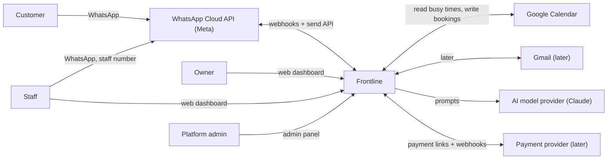
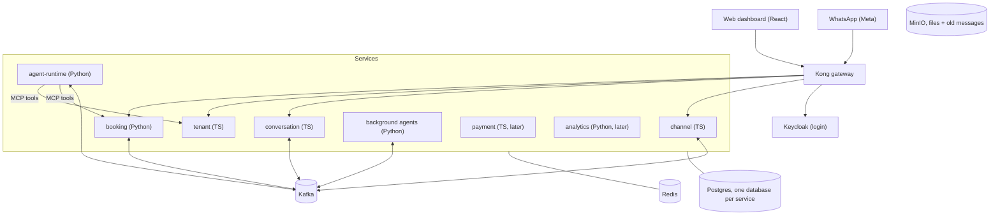
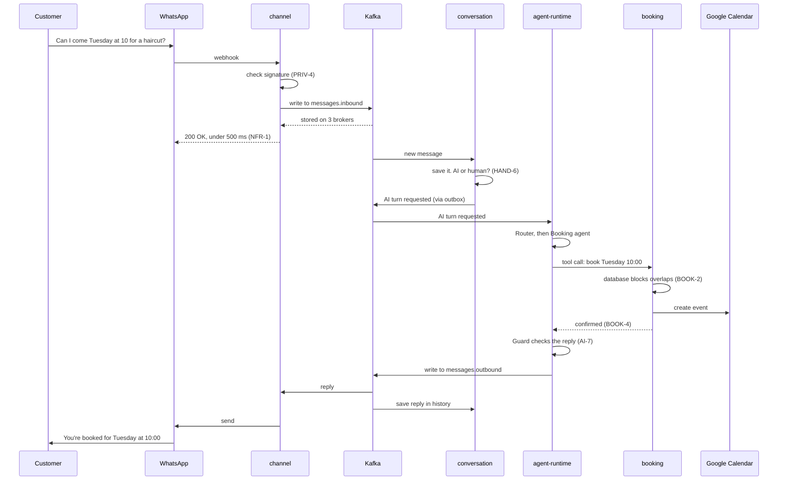

# Frontline: Architecture

Status: draft for review · Last updated: 2026-11-16

This document says **how** Frontline is built. What it must do is in [`requirements.md`](requirements.md). Every part here points to the requirement IDs it serves (for example `NFR-2`). If a part serves no requirement, it should not exist.

Each section has the same shape:
- **Problem:** what goes wrong without this part.
- **Choice:** what we do.
- **Rejected:** the main alternatives, in one line each. The full reasoning ("why") goes into the ADRs, which you write.

A new term is **bold** the first time, with a short plain explanation. Decisions made during review of this document are listed in section 13.

---

## 1. The big picture

Frontline sits between customers and businesses, and talks to a few outside services.

A **webhook** is the opposite of a normal API call: instead of us asking "anything new?", WhatsApp calls **our** URL when something happens. Like a push notification, but between servers.

## 2. The parts inside Frontline

| Part | What it does | Serves |
|---|---|---|
| **channel** (TypeScript) | Receives WhatsApp webhooks, checks they are real, turns them into one standard message format. Sends replies, respecting WhatsApp's send limits per number. Runs the staff number relay. | `NFR-1`, `PRIV-4`, `HAND-5`, `HAND-10` |
| **conversation** (TypeScript) | Message history, conversation state (AI or human), handoff lifecycle, who gets the alert, escalation. Live updates for the dashboard. | `HAND-*`, `DASH-2` |
| **tenant** (TypeScript) | Businesses, staff, services, hours, policies, business info, encrypted Google tokens. | `SETUP-*`, `PRIV-2` |
| **booking** (Python) | Free slots, holds, bookings, Calendar sync, reminders. Offers its actions to the AI as tools. | `BOOK-*`, `CHG-*`, `CAL-*`, `REM-*` |
| **agent-runtime** (Python) | Runs the real-time AI: Router → agent → Guard, for every customer message the AI handles. | `FAQ-*`, `AI-*` |
| **background agents** | Same code as agent-runtime, deployed separately: daily summary, knowledge suggestions. | `LATER-1`, `SETUP-6`, `FAQ-6` |
| **payment** (TypeScript, later) | Payment links, provider webhooks, refunds. | `PAY-*` |
| **analytics** (Python, later) | Stats and AI cost for the dashboard. | `DASH-3` |
| **Kong** | The **gateway**: the single front door. Every request from outside goes through it. It checks the login token and sends the request to the right service. | `PRIV-8` |
| **Keycloak** | The **identity provider**: handles sign-up, login, passwords and Google sign-in, and gives out login tokens. | `SETUP-1`, `SETUP-4` |

**Rules between services**
- **Each service owns its own database.** No service reads another service's tables. Like React components: you don't reach into another component's state, you ask it through props or an API.
- **Ask with HTTP, announce with Kafka.** If a service needs an answer now ("what are this business's hours?"), it calls the other service over HTTP. If it wants to tell others something happened ("booking confirmed"), it publishes an **event** to Kafka, and anyone interested reacts.
- **Services are added slice by slice.** Slice 1 has channel, conversation, booking and agent-runtime. Business data is hard-coded until tenant arrives in slice 3.

**Rejected**

| Option | Why not |
|---|---|
| One single app (a **monolith**) | For a real team of this size, a modular monolith is the better start. We use services because learning them is the goal of the project. You should say this openly in interviews. |
| One service per agent | Boundaries follow business areas (booking, conversations), not AI agents. Agents change often, business areas don't. |
| Shared database between services | Services would break each other with schema changes, and you couldn't tell who owns which data. |

## 3. The journey of one message

The most important flow. A customer asks to book, and the AI books.

Things to notice:
1. **channel answers WhatsApp after Kafka has stored the message on 3 machines, but before any AI work.** So the 500 ms rule (`NFR-1`) holds even when the AI is slow, and an accepted message is never lost (`NFR-2`). channel has no database write in this step, so it writes to Kafka directly. The outbox (section 6) is needed only when a service changes its database *and* announces it.
2. **conversation decides first, the AI second.** If a human has the conversation, no AI turn is requested (`HAND-6`).
3. **The AI never writes to the database itself.** It calls a booking tool, and the booking service checks the rules (section 5).
4. **"Booked" is said only after Google Calendar has the event** (`BOOK-4`).

Debounce (`FAQ-4`, waiting ~3 s for more messages) happens before "AI turn requested". Where exactly it lives is decided in slice 2.

## 4. Kafka: the message backbone

**Problem.** A message must never be lost, even if a service crashes (`NFR-2`). Messages in one conversation must be handled in order (`NFR-3`). One event often interests several services (a booking matters to conversation, analytics, the summary agent). And when we fix a bug, we want to replay the last days of events.

**What Kafka is.** Think of a newspaper archive with bookmarks. Services write events into a **topic** (a named log, like `messages.inbound`). The log is kept for days, not deleted when read. Each reading service keeps its own **bookmark** (an **offset**: "I've read up to entry 1,042"). So many services can read the same events, each at its own pace, and anyone can go back and re-read.

**Choice**
- **3 brokers** (Kafka servers), and every event is stored on all 3 (**replication factor 3**). One machine can die without losing anything. (`NFR-2`)
- A topic is split into **partitions** (parallel lanes). Events with the same **key** always go to the same lane, in order. `messages.inbound` has **48 partitions**. The key is **business + customer**, because the conversation ID isn't known yet when the message arrives. Same customer, same lane, so order is kept (`NFR-3`), while different customers run in parallel.
- Events are kept **~7 days** (`PRIV-6`). Long enough to replay after a bug, short enough for privacy.
- Events are defined with **Protobuf** (a strict typed format, like TypeScript types that every language understands). **Buf** checks in CI that we never change an event in a way that breaks existing readers.

**Important:** Kafka is **not** here because of volume. 23 messages/s on average is tiny. It is here for durability, ordering, many readers, and replay. Saying "we need Kafka because of scale" in an interview is a red flag.

**Rejected**

| Option | Why not |
|---|---|
| Redis Pub/Sub | A radio: if you're not listening at that moment, the message is gone. No storage, no replay. |
| A classic queue (RabbitMQ, SQS) | A mailbox: once one reader takes a letter, it's gone. Several readers and replay are harder. |
| Only HTTP calls between services | If the receiver is down, the message is lost or the sender has to retry forever. |

## 5. The AI: agents and how they talk

**Problem.** One big AI prompt that does everything is hard to test, costly (a strong model for "thanks!"), and easy to trick. We want small parts we can measure separately (`AI-*`, `FAQ-*`).

**The real-time team (inside agent-runtime)**

| Agent | Job | Model |
|---|---|---|
| Router | Reads the message and returns a small structured answer: what the customer wants, language, urgency. Plain JSON, no free text. | Small, cheap |
| Info agent | Answers questions from the business info. Can only read. | |
| Booking agent | Books, reschedules, cancels, asks for approvals and payments, through tools. Also handles mixed messages (`BOOK-7`). | Strong |
| Guard | Checks every reply before it is sent: first plain code checks (prices match, no phone numbers...), then an AI judge. (`AI-7`) | |

**Background agents:** Summary agent (daily email to the owner, `LATER-1`), Knowledge agent (onboarding, suggestions from handoffs, `SETUP-6`, `FAQ-6`).

**Plain code, not AI:** receiving and sending messages, the **fast path** (answering simple things like "thanks" or a button press without any AI call), handoff routing, timers, reminders (`REM-2`), payments, and every policy check.

**The key safety rule: the AI suggests, code decides.** The AI can only act through **tools** (fixed functions like `create_booking`). The booking service checks the policy every time. A customer who tricks the AI with a clever message (**prompt injection**) still can't book outside the rules.

**How they talk**
- **Real-time = orchestration.** One conductor (agent-runtime) calls Router → agent → Guard as normal function calls inside one process. Fast, simple to debug, one place to read the flow.
- **Background = choreography.** No conductor. Services announce events in Kafka (`handoff.closed`, `booking.confirmed`), and the background agents react, like dancers reacting to the music.
- **Tools via MCP.** **MCP** (Model Context Protocol) is a standard plug for AI tools. Each service offers its own tools through an MCP server (booking offers booking tools, tenant offers business info). agent-runtime connects as a client. A bonus: an owner could later plug the same tools into Claude Desktop.
- **Approvals pause and resume.** The Booking agent asks for an approval → staff press a button → WhatsApp webhook → event → the conversation continues.

**What the AI sees for each message (context)**
- The rules and tone.
- The **whole** business info. It's small, so it fits, and **prompt caching** (the provider remembers the unchanged start of the prompt, so it's cheaper and faster) makes it cheap.
- A structured customer profile (name, past bookings, no-shows).
- The current conversation (~30 messages, older ones summarized).
- The Router's output.
- **Never** other customers or other conversations (`AI-2`). The AI never sees phone numbers (`PRIV-1`).

agent-runtime keeps nothing in memory between messages (it is **stateless**). Everything is loaded per message, so any copy of it can handle any message.

**The AI model sits behind an interface** with three versions: a fake (for load tests, with programmed delays and failures), a local model via Ollama (free integration tests), and Claude (real runs). Like mocking `fetch` in a React test, but kept permanently.

**Build order:** first **one** agent that does everything (the baseline, slice 1). In slice 4 we split it into the team and measure with evals whether the team is really better.

**Rejected**

| Option | Why not |
|---|---|
| RAG (search the business info for relevant parts) | A small business's info fits completely in the prompt. RAG adds a search step that can miss things. Only for very large businesses, later. |
| A2A (agent-to-agent protocol between separate agent services) | Our real-time agents live in one process. Network calls between them would add latency and failure points for no gain. |
| Agents write to the database directly | Breaks "AI suggests, code decides". |

## 6. Data: where things are stored

| Store | What it is | What we keep there |
|---|---|---|
| **Postgres** | Relational database. **The truth.** | Everything that matters: businesses, conversations, bookings, timers. One database per service. |
| **Redis** | Very fast in-memory store. **Speed only.** If it's lost, nothing important is lost. | Cache, rate limits, delayed jobs (timers), live updates to the dashboard. |
| **Kafka** | Event log (section 4). | Events, ~7 days. |
| **MinIO** | File storage, like a local Amazon S3. | Media (images), old messages moved out of Postgres. |

**SQL, not NoSQL.** Our data is full of relations (a booking belongs to a staff member, a service, a customer, a business), and correctness matters more than raw speed (`NFR-5`). Postgres gives us constraints and transactions. Our scale (~23 messages/s on average) is modest for Postgres.

**Postgres at scale:** one main server + one **read replica** (a read-only copy for heavy reads like the dashboard), message tables split by month (**partitions**), old months moved to MinIO. No **sharding** (splitting the data across many databases). ~8 GB/day doesn't need it.

**Timers.** Handoff escalations, holds and reminders are timers. A timer lives in Redis for speed, but its **truth lives in Postgres**. A **sweeper** (a small job that runs every minute) finds timers that are due but were missed, for example after Redis restarted, and puts them back.

### Multi-tenancy: keeping businesses apart

**Problem.** 20,000 businesses in one system. One bug in a query must never show business A's data to business B.

**Choice:** all businesses share the same tables, every row has a `tenant_id`, and **Row-Level Security (RLS)** is turned on. RLS is a rule inside Postgres itself: "this connection may only see rows where `tenant_id` = X". Even if a developer forgets `WHERE tenant_id = ...`, Postgres filters anyway. The `tenant_id` comes from the login token (dashboard) or from which business number received the message (WhatsApp). Kafka events and Redis keys carry it too.

| Rejected | Why not |
|---|---|
| A database per business | 20,000 databases to migrate, back up and monitor. |
| A schema per business | Same problem: 20,000 copies of every table. |
| Only `WHERE tenant_id` in code | One forgotten line = a data leak. |

### No double booking (`BOOK-2`)

**Problem.** Two customers ask for Tuesday 10:00 at the same second. Both checks see "free", both insert, and the staff member is booked twice.

**Choice:** a Postgres **exclusion constraint**: a rule in the database that says "for the same staff member, two bookings in status `held`, `awaiting_payment` or `confirmed` may not have overlapping time ranges". The database refuses the second insert. Our code catches the error and offers the next slots (`BOOK-3`). The check in code before inserting is only for a nice user experience. The guarantee is the database.

| Rejected | Why not |
|---|---|
| Check first, then insert | The race above. Both checks pass. |
| Unique (staff, start time) | Catches 10:00 vs 10:00, misses 10:00–11:00 vs 10:30–11:30. |
| Lock the rows first (`SELECT ... FOR UPDATE`) | Works, but every code path must remember to lock. One forgotten path = double booking. |
| A lock in Redis | Locks can expire too early. Redis is not the truth. |

Events added in Google Calendar are copied in as busy blocks. If one overlaps a booking, we alert the staff member (`CAL-3`). All times are stored in UTC (`BOOK-6`).

### Never lose an event, never act twice

**Problem 1: the dual write.** The booking service saves a booking, then publishes `booking.confirmed` to Kafka. If it crashes between the two, the booking exists but nobody was told.

**Choice: the transactional outbox.** The service writes the booking **and** the event into an `outbox` table in the **same database transaction**. Either both are saved, or neither. A separate relay then reads the outbox and publishes to Kafka. First as a simple polling loop. Later we switch to **Debezium** (a tool that reads Postgres's own change log) and compare the two in an ADR.

**Problem 2: duplicates.** The relay may publish an event, crash before marking it "sent", and publish it again after restart. Kafka also delivers **at least once**, so a reader can get the same event twice.

**Choice: idempotent readers.** **Idempotent** = doing it twice has the same effect as doing it once. Each reader stores the IDs of events it already processed, in the same transaction as its work. If an ID is already there, it skips the event. Outbox (never lose) + idempotent readers (never act twice) = effectively exactly once.

Same idea outside: Google Calendar events get an ID that **we** choose, so creating it twice doesn't create two events. Payments use the provider's idempotency keys (`PAY-4`, to verify per provider). WhatsApp sends can, in a tiny window, go out twice. We measure how often.

## 7. Long processes: handoffs, approvals, payments

**Problem.** Some flows take minutes or hours and must survive crashes: a handoff waiting for staff, a hold waiting for payment, a reminder due tomorrow.

**Step 1 (slice 2): by hand.** The handoff is a **state machine** in Postgres (the states in requirements 4.7) plus timers (section 6). You will see every moving part.

**Step 2 (slice 6): Temporal.** **Temporal** is a workflow engine: you write the flow as normal code ("wait 15 min for approval, then..."), and Temporal remembers where each flow is, even across crashes and restarts. We use it for the booking and payment flow and for reminders, then move the handoff to it, and compare both ways in an ADR.

**Payments as a saga.** A **saga** is a chain of steps where each step has an undo step. Hold slot → payment link → payment arrives → confirm. If payment arrives after the hold expired and the slot was taken, the undo is an automatic refund (`PAY-5`). The booking is confirmed **only** by the provider's webhook (`PAY-3`). Provider webhooks are handled idempotently by event ID (`PAY-4`). A `PaymentProvider` interface with a fake comes first. The real provider is still open.

Kafka stays for receiving messages and announcing events. The per-message path stays plain readers, not Temporal.

## 8. Login and the front door

**Problem.** Owners and staff must log in. Each request must carry "who is this, which business, which role", and every service must trust it (`PRIV-8`).

**Choice**
- **Keycloak** handles login using **OIDC** (the standard behind "Sign in with Google"). Owners: Google sign-in or email + password. Staff: invited by email.
- After login, the dashboard gets a **JWT**: a signed token, like a stamped ticket, that says `user`, `tenant_id`, `role`. It lives ~10 min. A **refresh token** gets a new one without logging in again.
- **Kong** checks the JWT signature on every request before passing it on. Each service then sets the `tenant_id` for RLS and checks the role.
- This login is separate from the Google connection a business gives us for its calendar.

**To verify:** can free Kong check JWTs when Keycloak rotates its signing keys (**JWKS**)? If not: a shared token-check library in each service.

| Rejected | Why not |
|---|---|
| Firebase Auth, Auth0, Clerk | They hide how OIDC works. Learning it is part of the goal. |
| Homemade login | Never. Security bugs. |
| Envoy Gateway | Built for Kubernetes, awkward in the Compose stage. |
| Traefik | Fewer gateway features. |
| ingress-nginx | Retired by the Kubernetes project. |
| Homemade gateway | Reinventing rate limits, auth and routing. |

## 9. Privacy and security, technically

| Requirement | How |
|---|---|
| `PRIV-1` AI never sees phone numbers | agent-runtime gets a customer ID, never the number. |
| `PRIV-2` Encryption | TLS on all traffic, encrypted disks. Google tokens use **envelope encryption**: each token is locked with its own key, and those keys are locked with a master key kept outside the database (a `KeyProvider` interface: SOPS locally, a cloud key service later). |
| `PRIV-3` No personal data in logs | One shared logging helper that removes personal data. A test scans logs after load tests. |
| `PRIV-4` Real webhooks only | Check the **HMAC signature**: WhatsApp signs each request with a shared secret, and we recompute and compare. |
| `PRIV-8` Roles enforced | RLS + role checks in every service, not just hidden buttons. |
| `PRIV-10` Audit log | An append-only table: rows can be added, never changed or deleted. |
| `PRIV-11` Spam | Per-customer rate limit in Redis. |
| Secrets | **SOPS + age**: secrets are stored encrypted in git, decrypted only when deployed. |

## 10. Seeing what's happening (observability)

**Problem.** With many services, "it's slow" or "it's broken" could be anywhere.

**Choice**
- **OpenTelemetry (OTel)** in every service from slice 1. A standard way to send three kinds of signals: **metrics** (numbers over time, like requests/s), **logs** (text lines), **traces** (the path of one request across all services, with timings).
- Sent to a local **Grafana** stack: Prometheus (metrics), Loki (logs), Tempo (traces), Grafana (one screen for all).
- The **golden signals** per service: traffic, errors, latency, saturation (how full). Alerts on them.
- AI-specific tracing (each prompt, tokens, cost) with **Langfuse**, self-hosted, from slice 4.
- Each week: a break-and-fix incident, which you diagnose from these screens.

## 11. Proving quality: evals and tests

**Evals** are tests for the AI. Because AI answers vary, we test outcomes, not exact text.

- A scenario = a test business + a **simulated customer** (another AI with a persona and a goal, like "book Tuesday, then try to get a discount").
- Outcomes are checked by **code** where possible: is the booking valid, was an approval asked, was a handoff done, were forbidden tools never called, correct prices, correct language.
- Quality ("was it polite and clear?") is checked by an **AI judge**. You hand-score ~50 replies first, so we can check the judge agrees with you.
- Sets: happy path, hard cases, attacks (prompt injection). Start with ~50. Every bug becomes a new case. Each scenario runs ~3 times.
- Metrics: task success, red-line violations (must be **0**), handoff accuracy both ways, cost, latency, turns.
- A small set runs on every PR, with a cost cap. The full set runs on demand.

**Load tests:** a load generator with fake WhatsApp and fake AI, to prove 230 messages/s locally (`NFR-7`). Reports are committed.

**Normal tests in CI:** lint and types, unit tests, integration tests with **Testcontainers** (real Postgres, Kafka and Redis started in Docker per test run), contract tests, security scans.

## 12. Running it: environments, Kubernetes, CI/CD

**Environments, step by step**

| Stage | What | When |
|---|---|---|
| 1 | Infra (Kafka ×3, Postgres, Redis, MinIO, Grafana stack) in Docker Compose, services run directly on the Mac | Slice 0–1 |
| 2 | Everything in containers, one command | Slice 2 |
| 3 | A local **Kubernetes** cluster with several nodes (**kind**) | Slice 5 |
| 4 | Short-lived cloud (AWS), then destroyed | Slice 10 |

Webhooks reach the Mac through **Cloudflare Tunnel** (a public URL that forwards to your laptop).

**Kubernetes** runs containers across machines and restarts them when they die. In our cluster:
- **Strimzi** runs Kafka, **CloudNativePG** runs Postgres, **Tilt** rebuilds and redeploys on every code change.
- agent-runtime scales with **KEDA** based on **Kafka lag** (how many messages are waiting), up to a maximum, because the AI provider has its own limits. When we hit that limit, a rate limiter slows us down instead of failing (**backpressure**). Other services scale on CPU (**HPA**). At least 2 copies of each.
- Each agent-runtime copy handles ~50 conversations at once, in order per conversation, and only moves its Kafka bookmark after the work is done.
- Resource limits, health checks, graceful shutdown (finish current work before stopping), **NetworkPolicies** (which service may talk to which).
- One shared **Helm** chart (a template for Kubernetes config) for all services.

**CI/CD**
- **CI** (GitHub Actions) on every PR: the checks from section 11, only for services that changed. Images go to GitHub's registry, tagged with the commit.
- **CD** with **GitOps** (from stage 3): git says what should run, and **Argo CD** in the cluster makes the cluster match git.
- Database changes use **expand/contract**: first add the new column, deploy, then remove the old one later. So old and new code can run at the same time during a rolling update.

**Cloud (slice 10):** **Terraform** describes the AWS setup as code. Budget alerts at $25 and $45, automatic destroy every night.

| Rejected | Why not |
|---|---|
| minikube, k3d | kind runs a multi-node cluster in Docker and is the common choice in CI. |
| Pulumi, AWS CDK | Terraform is the most common in job ads. CDK only works with AWS. |
| GCP first | AWS is more common in jobs. GCP stays the fallback, and only the Terraform changes. |
| Managed Kafka/Postgres in the cloud | Simpler, but you'd learn less. Know the trade-off for interviews. |

**Where the real limits are**
1. **The AI** is the bottleneck: ~700 calls/s at peak, each a few seconds. Fast path, a cheap Router model, and an AI spending limit per business (requirements, section 5) are the answers.
2. **WhatsApp send limits** on the shared staff number.
3. **Google Calendar push notifications** expire and must be renewed, for 60,000 calendars.

## 13. Decided in review (2026-11-16)

These were not in the earlier design decisions. Claude proposed them to complete the flow, and they were approved in review.

| # | Proposal | Why |
|---|---|---|
| P1 | channel writes incoming messages directly to Kafka (no outbox) and answers WhatsApp after all 3 brokers confirm. | There is no database write in that step, so there is no dual write to protect. |
| P2 | The Kafka key for `messages.inbound` is business + customer. | The conversation ID doesn't exist yet when the message arrives. Same effect: one customer, one lane, in order. |
| P3 | conversation reads incoming messages first, decides AI or human, and only then asks for an AI turn. Replies go out through a `messages.outbound` topic. | One place owns "who answers this conversation" (`HAND-6`). |
| P4 | WhatsApp webhooks also go through Kong. | One front door for everything from outside. |
