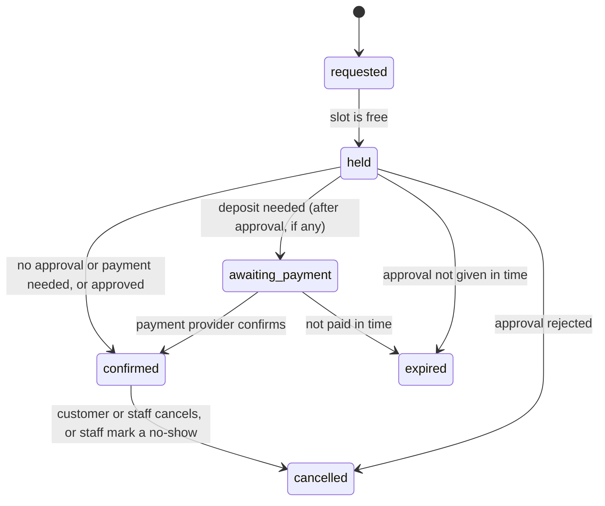
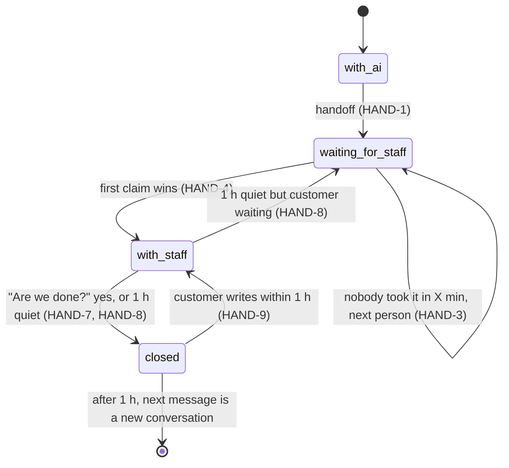

# Frontline: Requirements

Status: draft for review · Last updated: 2026-11-16

This document says **what** Frontline must do and **how well**. It does not say how it is built. That is in `architecture.md` (next) and in the ADRs.

Every requirement has an ID (for example `BOOK-3`). Later, ADRs, tests and evals point to these IDs, so we can always answer "why does this part exist?".

Words used: **must** = required. **should** = wanted, but can wait. **later** = designed now, built in a later slice (the slice number is in brackets, see the roadmap in the last section).

---

## 1. The product in short

Small businesses that work by appointment (hair salons, clinics, personal trainers) lose customers because nobody answers WhatsApp fast enough. Frontline is an AI front desk for them.

- Customers write to the business on **WhatsApp** (and later email), as they do today.
- A small team of AI agents answers questions, books, reschedules and cancels appointments in the staff's **Google Calendar**, and sends reminders.
- When a human is needed, the conversation goes to one staff member, who answers **inside WhatsApp**.
- The owner sets things up and keeps an eye on everything in a **web dashboard**.

Many businesses use the same system at the same time, and each one only ever sees its own data. This is called **multi-tenant**: each business is a "tenant", like apartments in one building.

## 2. Words used in this document

| Word | Meaning |
|---|---|
| Business | One customer of Frontline (a salon, a clinic). |
| Owner | The person who runs the business. |
| Staff | People who work for the business. Each has their own Google Calendar. The owner can also be staff. |
| Customer | A person who writes to the business on WhatsApp or email. Never logs in anywhere. |
| Platform admin | Us, the people who run Frontline itself. |
| Conversation | One exchange between a customer and a business. A new one starts after 24 hours of silence or after a human closes it. |
| Handoff | Moving a conversation from the AI to a human staff member. |
| Approval | The AI asks a staff member "Approve / Reject?" before doing something outside the rules. |
| Policy | A rule the business sets, for example "cancel free until 24 h before". |
| Hold | A slot kept for a customer for a short time while we wait for an approval or a payment. |
| Staff number | A separate WhatsApp number run by Frontline. Staff talk to customers through it during a handoff. |
| 24-hour window | A WhatsApp rule: a business can send free text only within 24 h of the person's last message. Outside it, only pre-approved **template** messages are allowed, and each one costs money. |

## 3. Who uses Frontline

| Role | How they use it | What they can see and do |
|---|---|---|
| Customer | WhatsApp, later email | Their own conversations and bookings. Nothing else. |
| Staff | Mostly WhatsApp (via the staff number), sometimes the dashboard | **Only** conversations assigned to them, the queue of unassigned conversations, and their own calendar. |
| Owner | Dashboard (setup and oversight), WhatsApp for handoffs | Everything in their own business. |
| Platform admin | Admin panel | System health, usage, cost per business. **No** conversation content, unless they turn on a "support access" switch, which is logged (`PRIV-9`). |

## 4. Features

### 4.1 Setup (onboarding)

| ID | Requirement |
|---|---|
| SETUP-1 | The owner signs up with Google sign-in or email + password. [3] |
| SETUP-2 | The owner connects the business WhatsApp number and each staff member's Google Calendar. [1 hard-coded, 3 real] |
| SETUP-3 | The owner enters services (name, length, price), opening hours, staff and their working hours, policies, and business info (address, parking, FAQ answers...). [3] |
| SETUP-4 | The owner invites staff by email. [3] |
| SETUP-5 | The owner writes the sentence the AI uses to say it is an assistant (see `AI-6`). [3] |
| SETUP-6 | Later: the system helps fill business info from material the owner gives (website text, a price list). The owner approves before the AI uses it. [8] |

### 4.2 Answering questions

| ID | Requirement |
|---|---|
| FAQ-1 | The AI answers questions using **only** the business info. [1] |
| FAQ-2 | If the answer is not in the business info, the AI does **not** guess. It hands off (`HAND-1`). [1] |
| FAQ-3 | The AI replies in the language the customer writes in: Hebrew or English. [1] |
| FAQ-4 | If a customer sends several messages quickly, the AI waits a moment (about 3 s) and answers them together. [2] |
| FAQ-5 | Voice notes: the AI politely asks the customer to write instead, and we count how often this happens. Later: turn speech into text. [2, 9] |
| FAQ-6 | Later: after a handoff, the system may suggest a new FAQ answer from what the staff member wrote. The owner approves it first. [8] |

### 4.3 Booking

| ID | Requirement |
|---|---|
| BOOK-1 | The AI shows free slots and books an appointment for a service with a staff member, within the business rules (hours, service length, staff working hours). [1] |
| BOOK-2 | **No double booking, ever.** Two active bookings can never overlap for the same staff member, even if two customers ask for the same slot at the same second. [1] |
| BOOK-3 | If the slot was just taken, the AI apologises and offers the next free slots. [1] |
| BOOK-4 | The AI never says "booked" before the booking is really saved in the calendar. [1] |
| BOOK-5 | Whether **new** customers can book alone or need an approval is a business setting. [6] |
| BOOK-6 | All times are stored in UTC and shown in the business's local time. [1] |
| BOOK-7 | One message can mix things ("what's the price, and can I come Tuesday?"). The AI handles both parts. [1] |

**Booking states.** A slot is blocked while the booking is `held`, `awaiting_payment` or `confirmed`. A `cancelled` booking keeps a reason (for example `customer_cancel`, `late_cancel`, `rejected`, `no_show`), so stats can tell them apart.

### 4.4 Reschedule and cancel

| ID | Requirement |
|---|---|
| CHG-1 | The AI reschedules or cancels alone if the business policy allows it. [1] |
| CHG-2 | Outside the policy (for example, a late cancel), the AI asks for an approval (`APPR-1`). [6] |
| CHG-3 | When an out-of-policy cancel is approved, the business keeps the deposit, if there was one. Without a deposit, there is no automatic consequence. [7] |

### 4.5 Reminders and no-shows

| ID | Requirement |
|---|---|
| REM-1 | Customers get a reminder before the appointment. The business chooses when. [6] |
| REM-2 | Reminders are plain scheduled messages, not AI. They must be sent once, on time, and never twice. [6] |
| REM-3 | We assume every customer came. Staff mark a no-show in the dashboard. [6] |
| REM-4 | A no-show is treated like an approved out-of-policy cancel: the booking becomes `cancelled` with reason `no_show`, and the deposit is kept (`CHG-3`). [6, 7] |
| REM-5 | No-shows are counted per customer and shown to staff and in stats, separately from late cancels. [6] |

### 4.6 Calendar sync (both ways)

| ID | Requirement |
|---|---|
| CAL-1 | Bookings appear in the staff member's Google Calendar. [1] |
| CAL-2 | Events the staff add in Google Calendar count as busy time. Changes show up within a short time, without staff doing anything. [3] |
| CAL-3 | If an event added in Google overlaps an existing booking, we **alert the staff member**. We don't fix it silently. [3] |

### 4.7 Handoff to a human

| ID | Requirement |
|---|---|
| HAND-1 | The AI hands off when: the info is missing, the customer asks for a discount, complains, asks for a human, or the request is unclear. [2] |
| HAND-2 | The alert goes to **one** staff member: the staff member of the customer's booking, else the on-shift staff member with the fewest open conversations. [2] |
| HAND-3 | If nobody takes it within X minutes (X set per business), it goes to the next staff member, then to the owner. [2] |
| HAND-4 | If two staff members try to take it, the first one wins. The other is told. [2] |
| HAND-5 | Staff answer in WhatsApp, through the staff number. They reply by quoting the customer's message. If they don't quote, a short tag in the message is used instead. [2] |
| HAND-6 | Once a human has the conversation, the AI stays silent in it until it is closed. [2] |
| HAND-7 | After about 15 min of silence, the staff member gets "Are we done?" buttons. No typed commands like "done". [2] |
| HAND-8 | After 1 h without activity the conversation closes, **unless** the last message is a customer message nobody answered. Then it escalates instead (`HAND-3`). [2] |
| HAND-9 | For 1 h after closing, a new customer message goes back to the same staff member. After that, the AI handles it as a new conversation. [2] |
| HAND-10 | Staff alerts outside the 24-hour window must use template messages (paid). [2] |

### 4.8 Approvals

| ID | Requirement |
|---|---|
| APPR-1 | The AI asks for an approval for: out-of-policy cancels and reschedules, new-customer bookings (if the business wants that, `BOOK-5`). [6] |
| APPR-2 | The staff member gets WhatsApp buttons: Approve / Reject. [6] |
| APPR-3 | While waiting, the slot is held for about 15 min. If nobody answers in time, the hold expires and the customer is told. [6] |
| APPR-4 | If a deposit is needed, the approval comes **before** the payment link. [7] |

### 4.9 Deposits and payments [7]

| ID | Requirement |
|---|---|
| PAY-1 | A business can ask for a deposit per service: a fixed amount or a percentage. Required always, only for new customers, or only for some services. |
| PAY-2 | The customer pays on the payment provider's own page (a link). Frontline never sees card numbers. |
| PAY-3 | A booking becomes `confirmed` **only** when the payment provider tells us the payment succeeded. Never because the customer says "I paid". |
| PAY-4 | No customer is ever charged twice for the same booking, even if the provider tells us about the same payment more than once. |
| PAY-5 | If a payment arrives after the hold expired and the slot was taken, the customer gets an automatic refund and is told. |
| PAY-6 | While waiting for payment, the slot is held for about 15 min. If the customer doesn't pay in time, the hold expires and the customer is told. |

### 4.10 Dashboard

| ID | Requirement |
|---|---|
| DASH-1 | Setup: everything in 4.1. [3] |
| DASH-2 | Oversight: see all conversations (owner) or own conversations (staff), search, live updates, review and correct AI answers. [3] |
| DASH-3 | Insight: stats (bookings, handoffs, no-shows, voice notes) and AI cost. [3, 8] |
| DASH-4 | Hebrew and English. Hebrew is right-to-left. [3] |
| DASH-5 | Daily work happens in WhatsApp. The dashboard is not needed for normal daily work. |

### 4.11 Later features

| ID | Requirement |
|---|---|
| LATER-1 | Daily summary email to the owner. [8] |
| LATER-2 | Customers can also write by email (Gmail). Mainly for learning. [8] |
| LATER-3 | Admin panel for the platform admin (`PRIV-9`). [8] |
| LATER-4 | Staff-editable notes about a customer, suggested by the AI. Never health details. [9 or later] |

## 5. What the AI may do alone

The rule behind this table: **the AI suggests, code decides.** The AI can only act through fixed actions (book, cancel...), and the code checks the policy every time. So even if a customer tricks the AI with a clever message, the code still says no.

| Situation | AI does it alone? |
|---|---|
| Answer a question that is in the business info | Yes |
| Answer a question that is **not** in the business info | No: handoff |
| Book within the rules | Yes (new customers: business setting) |
| Reschedule / cancel within the policy | Yes |
| Reschedule / cancel outside the policy | No: approval |
| Discount, complaint, unclear request | No: handoff |
| Send reminders | Not AI at all: plain scheduled messages |

| ID | The AI must **never** |
|---|---|
| AI-1 | Give medical advice. |
| AI-2 | Share anything about another customer or another conversation. |
| AI-3 | Say "booked" before the booking is saved (`BOOK-4`). |
| AI-4 | Promise a refund or a discount. |
| AI-5 | Invent information that is not in the business info (`FAQ-2`). |
| AI-6 | Hide that it is an AI. It says it is an assistant at the start of each conversation, with the business's own wording. |
| AI-7 | Send any message that hasn't passed a final safety check. |

AI cost is tracked per business, and each business has a spending limit.

## 6. Privacy and security rules

| ID | Requirement |
|---|---|
| PRIV-1 | Collect and use as little personal data as possible. The AI never sees customer phone numbers. |
| PRIV-2 | All traffic is encrypted. Stored data is encrypted. Google access tokens get extra encryption, with the key kept separately from the data. |
| PRIV-3 | No personal data in logs or traces. A test scans the logs to prove it. |
| PRIV-4 | We only accept messages that really come from WhatsApp, Google or the payment provider (each one is verified). |
| PRIV-5 | Conversations are kept 12 months by default. A business can choose less. |
| PRIV-6 | Temporary copies are deleted on a fixed schedule: internal message streams after 7 days, AI debugging traces after 14 days (restricted access), backups after 30 days. |
| PRIV-7 | A customer can ask to be erased. We erase them everywhere and keep a record that it was done. [9] |
| PRIV-8 | Staff see only what their role allows (section 3). This is enforced by the system, not just hidden in the screen. |
| PRIV-9 | Platform admins see no conversation content, except through a logged support-access switch. |
| PRIV-10 | Important actions (approvals, settings changes, support access) go into an audit log that can't be edited. [9] |
| PRIV-11 | Limit how many messages one customer can send. Flag spam. |
| PRIV-12 | Check the AI provider's data terms (do they keep or train on our data?). |
| PRIV-13 | A lawyer reviews privacy before any real business uses Frontline. |

## 7. Scale and quality targets

Frontline is a learning project, but it is **designed as if** it served 20,000 businesses. We prove it with a load test on one Mac, using fake WhatsApp and fake AI. We describe it honestly: "designed for X, load-tested to Y".

**Scale numbers (assumed).** "Peak" = the busiest moment of the day. All businesses are in one time zone, so peaks happen together.

| What | Number | How we got it |
|---|---|---|
| Businesses / staff | 20,000 / 60,000 | ~3 staff per business |
| Incoming messages | 2M per day | ~100 per business per day |
| Average rate | ~23 messages/s | 2M ÷ 86,400 s |
| Peak rate | ~230 messages/s | 10× the average |
| AI calls at peak | ~700 per second | ~3 AI calls per message |
| AI calls running at once | ~2,100 | 700/s × ~3 s each |
| Reminders | 400,000 per day | |
| Stored messages | ~8 GB/day, ~3 TB/year | incoming + replies, ~2 KB each |

**Quality targets.**

| ID | Target | In plain words |
|---|---|---|
| NFR-1 | Accept an incoming WhatsApp message in under 500 ms | WhatsApp needs a fast "got it", or it sends the message again. |
| NFR-2 | No accepted message is ever lost | Even if a part of the system crashes. |
| NFR-3 | Messages in one conversation are handled in order | Never answer message 2 before message 1. |
| NFR-4 | 95% of AI replies within 10 s (p95 < 10 s) | Out of 100 replies, at least 95 are faster than 10 s. |
| NFR-5 | Zero double bookings, zero double charges | `BOOK-2`, `PAY-4`. |
| NFR-6 | Receiving messages works 99.9% of the time | At most ~43 minutes down per month. |
| NFR-7 | Handle 230 messages/s locally, with fake AI | The proof for this whole table. |

**Project limits.** About 30 h/week of work. About $100/month: ~$50 for real AI calls, ~$50 for short cloud tests. Most work runs locally on one Mac.

## 8. Out of scope

- Instagram and Facebook messages.
- Phone calls.
- A mobile app for owners or staff (WhatsApp + web dashboard is enough).

## 9. Open questions (to check before the slice that needs them)

| Question | Needed by |
|---|---|
| Does Israeli law require a specific AI disclosure? (`AI-6`) | Slice 1 |
| WhatsApp: real send limit per number, "coexistence" (the business keeps using the WhatsApp app on the same number), can a send be duplicated? | Slice 0 spike |
| Can staff also mark a no-show from WhatsApp, and on which message would the button be? (`REM-3`) | Slice 6 |
| Which payment provider? Stripe probably doesn't serve Israeli businesses; check Grow, Tranzila, Cardcom, PayPlus. | Slice 7 |

## 10. Roadmap (where each feature arrives)

| Slice | Content |
|---|---|
| 0 | Foundations: specs, ADRs, repo, local infra, CI, WhatsApp test-number spike |
| 1 | Walking skeleton: real WhatsApp booking with one AI agent, one hard-coded business |
| 2 | Conversations + handoff |
| 3 | Many businesses, login, dashboard, Calendar sync both ways |
| 4 | Evals, then split one agent into a team and measure the difference |
| ★ | Portfolio v1: README, architecture doc, demo |
| 5 | Scale: local Kubernetes, load test to 230 msg/s, break things on purpose |
| 6 | Approvals, reminders |
| 7 | Payments |
| 8 | Background agents, Gmail, stats, admin panel |
| 9 | Hardening: erasure, retention, audit log, encryption, voice notes |
| 10 | Short cloud deployment, then destroy it |
